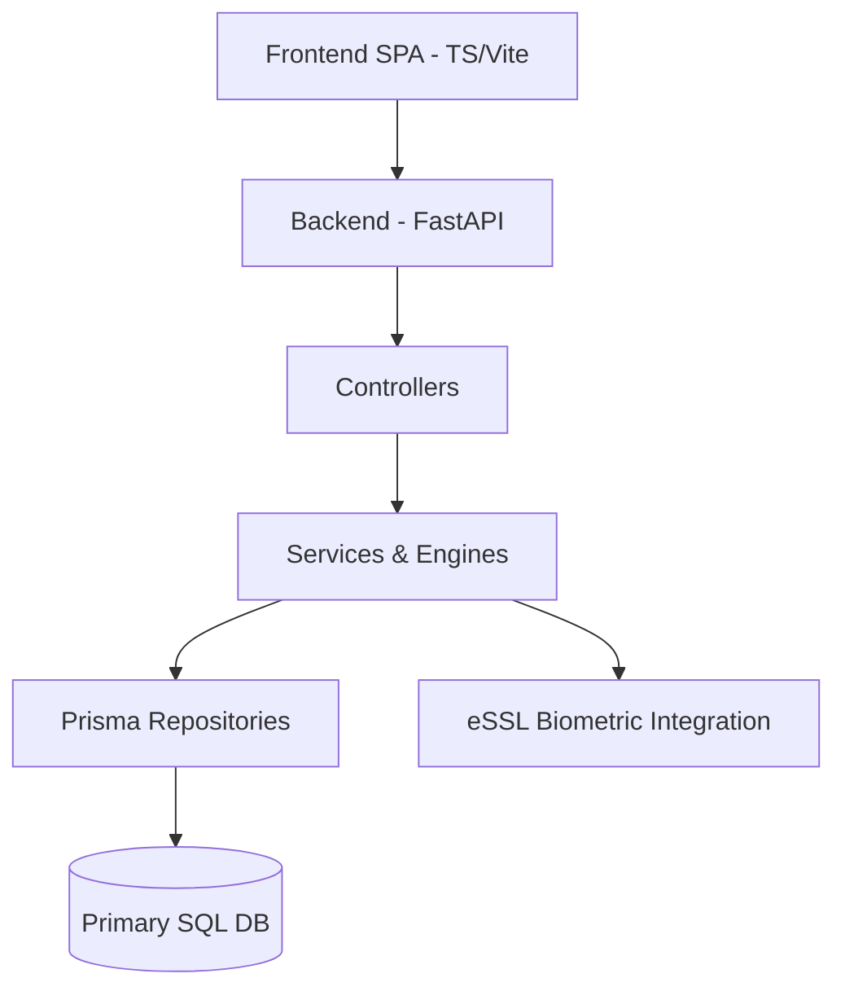

# 02 System Architecture

*Note: Background workers (Celery/RQ) presence is minimal or not completely decoupled based on static analysis, meaning high-load tasks might currently execute synchronously or in simple background threads.*
