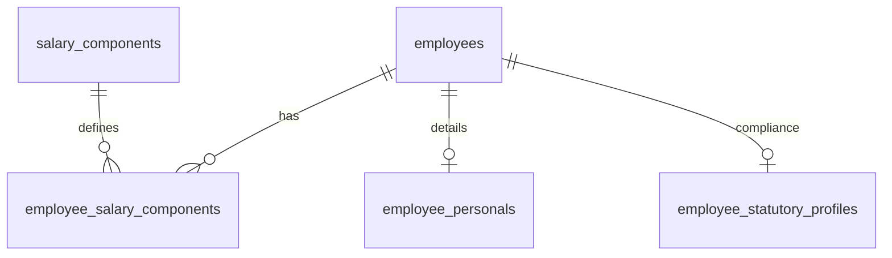

# 05 Database Schema And Data Flow

Based on `schema_dump.json`:

## Core Entities
- `companies`, `branchs`, `departments`
- `employees`, `employee_personals`, `employee_bank_accounts`, `employee_government_ids`, `employee_statutory_profiles`
- `salary_components`, `employee_salary_components`

## Data Flow for Payroll
1. Read `employee_salary_components` mapping to `salary_components`.
2. Evaluate `FormulaEngine` against `employee_statutory_profiles` (PF/ESI/PT).
3. Generate Payroll result.

