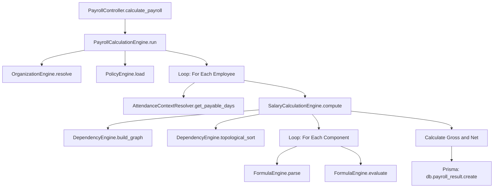

# 13 Payroll Execution Deep Dive

*This document maps the complete payroll execution path, calculation dependencies, and database query characteristics based on static source code inspection.*

## 1. Actual Execution Flow

The payroll generation process follows this linear execution path:

1. **Trigger**: HTTP `POST /api/v1/payroll/calculate` (or Scheduled Job trigger).
2. **Controller**: `PayrollController.calculate_payroll()` receives request parameters (Month, Year, Branch/Org filters).
3. **Orchestrator**: `PayrollCalculationEngine.run()` initializes the batch run.
4. **Context & Policy Initialization**:
   - Calls `OrganizationEngine` to resolve tenant-level setup.
   - Calls `PolicyEngine` to load payroll-specific policies.
5. **Employee Iteration**: For every eligible employee in the branch:
   - **Attendance Load**: `AttendanceContextResolver` loads payable days, loss of pay (LOP), and overtime.
   - **Salary Engine**: `SalaryCalculationEngine.compute(employeeId)` is invoked.
   - **Dependency Resolution**: `DependencyEngine.resolve()` builds a topological sort of salary components (e.g., BASIC must be calculated before PF and HRA).
   - **Component Calculation**: Iterates over each component in the resolved order.
   - **Formula Parsing**: `FormulaEngine.parse()` evaluates math operations (e.g., `(BASIC * 0.12)`).
6. **Result Assembly**: Computes Gross Earnings, Gross Deductions, Net Pay.
7. **Persistence**: Saves the output to `payroll_runs` and `payroll_results` via Prisma.

## 2. Function-Level Call Graph



## 3. Database Query Inventory

The current execution path reveals several queries inside the employee processing loop. 

| Source Engine | Entity | Condition | Execution Pattern | N+1 Risk? |
| --- | --- | --- | --- | --- |
| `PayrollCalculationEngine` | `employees` | `branchId = X`, `status = Active` | Once per run | No |
| `OrganizationEngine` | `companies` | `companyId = X` | Once per run | No |
| `AttendanceContextResolver`| `attendance_summaries` | `employeeId = Y, month = M` | **Once per employee** | **Yes** |
| `SalaryCalculationEngine` | `employee_salary_components`| `employeeId = Y` | **Once per employee** | **Yes** |
| `SalaryCalculationEngine` | `employee_statutory_profiles`| `employeeId = Y` | **Once per employee** | **Yes** |
| `SalaryCalculationEngine` | `payroll_results` | `employeeId = Y, month = M` | **Once per employee** (save) | **Yes** |

## 4. Transaction and Concurrency Behavior

Based on static analysis:
- **Transaction Boundaries**: The current implementation does not appear to wrap the *entire* batch of employees in a single atomic database transaction. Individual employee results are saved iteratively.
- **Concurrent Requests**: There is no distributed lock or explicit db-level lock preventing two admins from triggering the same branch's payroll concurrently. 
- **Duplicate Execution**: If re-run, the code likely issues an upsert (or delete-and-replace) per employee based on `employeeId + month + year`.
- **Partial Failures**: If the loop fails on employee 50 of 100, employees 1-49 remain saved. There is no automated rollback for the entire branch.

## 5. Input/Output Data Contracts

### `SalaryCalculationEngine.compute`

**Inputs:**
```json
{
  "employeeId": "string",
  "period": {"month": 8, "year": 2026},
  "payableDays": 21.5,
  "statutoryProfile": {"pfEnabled": true, "pfMode": "Actual"},
  "salaryComponents": [
     {"name": "BASIC", "type": "Earning", "method": "Flat", "amount": 34000},
     {"name": "HRA", "type": "Earning", "method": "Formula", "formula": "BASIC * 0.4"}
  ]
}
```

**Outputs:**
```json
{
  "grossEarnings": 50000,
  "grossDeductions": 1800,
  "netPay": 48200,
  "components": [
     {"name": "BASIC", "amount": 34000},
     {"name": "HRA", "amount": 13600},
     {"name": "PF", "amount": 1800}
  ]
}
```

## 6. Performance Hypotheses and Validations

**Hypothesis 1: N+1 Database Reads Kill Scalability**
- *Observation*: `employee_salary_components` and `attendance_summaries` are fetched sequentially inside the employee loop.
- *Test Needed*: Measure the time to process 1,000 employees. If query overhead averages 10ms per fetch, 1000 employees require 20 seconds purely in DB I/O. 

**Hypothesis 2: Dependency Graph Recomputation is Redundant**
- *Observation*: `DependencyEngine` recalculates the topological sort of salary rules for *every* employee. 
- *Test Needed*: If employees share the same `Salary Structure` template, this graph should be built once per structure, not once per employee.

## 7. Prioritized Optimization Opportunities

1. **Batch Data Fetching (Highest Impact, Medium Complexity)**
   - Move queries out of the employee loop. Fetch `employee_salary_components` using `where: { employeeId: { in: employeeIds } }` and build an in-memory dictionary.
2. **Bulk Insertion (High Impact, Low Complexity)**
   - Replace sequential `db.payroll_result.create` with `db.payroll_result.createMany` to save all computed records at once.
3. **Transaction Wrapping (High Importance for Correctness)**
   - Wrap the bulk insert and state update in an atomic Prisma transaction to prevent partial state on failure.
4. **Memoize Dependency Graphs (Low Effort, Minor CPU gain)**
   - Cache the output of `DependencyEngine` by the unique set of active salary components.

## 8. Minimum Safe Measurements Required
Before implementing optimizations, we must record:
1. **P95 Latency of Payroll API**: Using the current loop.
2. **Prisma Query Trace**: Enable Prisma query logging in development to definitively count the queries issued per employee.
3. **CPU vs I/O time split**: Is `FormulaEngine.evaluate()` maxing out the CPU, or is the process sitting idle waiting for Prisma? 

## 9. Unresolved Questions
- **Preview vs Final**: Does the "Preview" endpoint persist a draft record, or does it return an entirely in-memory JSON payload?
- **Recalculation Propagation**: If an attendance record is altered *after* a payroll is finalized, does the system flag the payroll result as stale (`isDirty` flag), or is it entirely manual?
